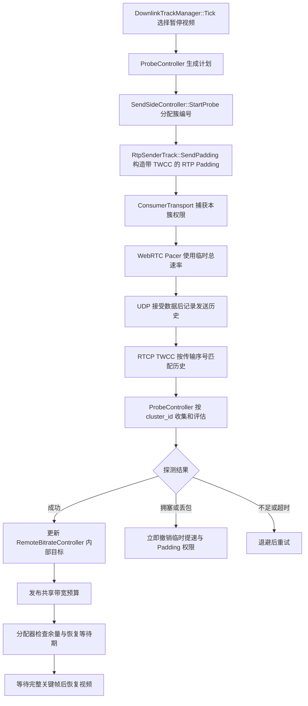

# 下行带宽探测闭环

这版实现用于单层 SFU 视频因带宽不足而暂停后的恢复探测。没有可投递、协商 TWCC 的暂停视频时，
不主动制造探测流量。每个下行 Transport 同时最多执行一个探测簇，音视频共享预算。
它是项目自己的受限恢复策略，尚未引入完整的 WebRTC ProbeController / ProbeBitrateEstimator。

## 从计划到恢复



`cluster_id` 是本地发送历史中的元数据，不新增 RTP 自定义字段。
发送时分配 TWCC 序号，反馈通过该序号找到发送历史，也就找到了探测簇。
`SendResult::Ok` 对异步 Transport 表示入队，只有发送完成回调才记录实际发送时间。
这里的 WebRTC 完成边界是 UDP socket 接受数据，不等同于网卡出线或对端收到。

## 计划与执行预算

计划入口现在按三个步骤阅读：

```text
OnProcessInterval
    → OnTime：推进上一轮超时
    → CheckStartConditions：检查执行状态、冷却、需求、余量和近期拥塞
    → BuildPlan：计算额外速率、总速率、时长和字节预算
```

`ProbeContext::bandwidth_estimate_time_ms` 来自产生该估计的 TWCC 本地接收时间。
最近 1000 ms 内的估计显示过载、丢包超过 5% 或丢包值非有限数时，不启动新探测。
这个检查也适用于码率估计尚在预热、但已经检测到拥塞的情况。
RTT 更新或查询状态不会刷新这份估计的时间；超过 1000 ms 的旧判断不再单独阻止恢复尝试，
避免全部视频暂停后，旧拥塞状态因缺少新反馈而永久阻塞探测。执行中和失败后的冷却约束仍然有效。

`DownlinkBandwidthAllocator::RequiredBudgetToResume(active_bps, candidate_bps)` 先查询恢复门槛。
它与 `ProvisionalAllocate()` 共用恢复预留的计算，并反向换算连接预算：

```text
resume_cost = floor(候选视频需求 × (100 + resume_margin_percent) / 100)
required_budget = ceil((活动媒体需求 + resume_cost) × 100 / usable_percent)
```

默认活动媒体为 1000 kbps、候选视频为 300 kbps 时，恢复预留为 360 kbps，
连接预算至少需要 `(1000 + 360) / 0.85 = 1600 kbps`。
查询使用整数向上取整，未知候选需求或算术溢出返回空值，不改变分配状态或恢复等待计时。
这是保留当前活动流、再恢复一个候选的预算门槛；实际分配仍按优先级和原有提交规则执行。

`DownlinkTrackManager` 先汇总活动流需求，再按优先级选择恢复门槛不超过配置最大码率的暂停视频，
将门槛放入 `ProbeRequest::required_budget_bps`。超过上限的候选不会阻挡其他可恢复的候选。

默认计划的总速率按下面的上界计算：

```text
target = 当前目标码率；尚无目标时使用 start_bitrate_bps
ceiling = min(max_bitrate_bps, max(1.5 × target, target + 64000))
desired = ceil(1.5 × required_budget)
total = min(ceiling, desired)
padding_bps = total - 活动媒体需求
```

这里沿用项目原有的 150% 探测余量，将其应用到恢复预算上；不代表 LiveKit 的默认参数。
探测余量用于覆盖测量保留的 10% 空间和保守 Padding 计费。
未提供恢复门槛的独立调用仍以“活动媒体需求 + 候选需求”作为基数，兼容原调用方式。
例如当前目标为 1200 kbps、恢复门槛为 1600 kbps，期望总速率为 2400 kbps，
但本轮增长上限只有 1800 kbps，最终仅探测至 1800 kbps；活动媒体为 1000 kbps 时，Padding 预算为 800 kbps。
预算缺口与 Padding 速率是不同的量。受到单轮上限和最大码率限制时，探测成功也可能仍未达到恢复门槛。

| 参数 | 当前实现 |
| --- | --- |
| 额外 Padding 预算 | `ProbePlan::bitrate_bps`，不包含活动媒体 |
| 临时总速率 | `ProbePlan::pacing_bitrate_bps`，包含活动媒体 |
| 单簇时长 | 500 ms，执行器也限制为不超过 500 ms |
| 字节上限 | `min(padding_bps × 500 / 8000, 128 KiB)` |
| 最小计划预算 | 1500 字节；更小的簇不启动 |
| 单次 Tick 上限 | 约 16 KiB，避免 Worker 停顿后集中补发 |
| 计费 | 每个 Padding 保守计 300 字节；反馈保留真实 RTP 大小 |

WebRTC Pacer 在执行期间使用普通速率和探测总速率的较大者，并限制到配置的最大码率。
到达截止时间、被取消、切网、断网或探测已判定拥塞后，恢复普通 Pacer 速率。
临时提速可直接通过 `SendSideController::GetPacingRate(now_ms)` 查询，不依赖 Worker 恰好按时执行清理。
其他协议仍使用各自的发送路径；本次没有新增其他协议的 Pacer。

## 入队后为什么还能发送

`Subscription::probe_cluster_id` 在整轮执行期间有效。
`ConsumerTransport` 给每个 Padding 捕获入队时的簇编号，发送前重新检查：

1. 订阅仍可投递；
2. 订阅当前簇编号与包捕获的编号相同；
3. 发送控制器确认该簇仍在当前路径、当前探测代次和截止时间内；
4. 该簇尚未结束或判定失败。

这样既允许 Tick 返回后异步出队，也防止下一轮探测重新放行上一轮遗留的包。
达到字节上限只停止继续入队，权限保留到执行截止时间，供已排队的包发送。
到期仍未发出的包失效，不会伪造发送完成记录。

## 反馈如何变成容量

执行器报告 `Finished`，算法仍需等待足够 TWCC；如果回执已经先到，也可在 `Finished` 时评估。
每簇最多保存 4096 条反馈，按扩展传输序号去重，支持分批和乱序回执。
发送和反馈时间属于本机时钟，接收时间属于对端时钟；只比较各自时钟内的时间间隔。

当前保守判据如下：

- 至少反馈 5 个探测包，且覆盖执行器已入队探测包数的 80%。未反馈的包不能充当回执。
- 已收到的探测包发送跨度至少 100 ms，且覆盖执行时长的 70%。
- 实际 Padding 接收字节对应的发送速率至少达到计划额外速率的 70%。
- 本轮时间范围内的媒体或 Padding 反馈显示过载、丢包超过 5% 时，立即取消提速。
  同时检查原始 TWCC 报告的丢包率，避免平滑后的估计暂未反映丢包。
- 至少反馈 5 个探测包、已收到探测包的发送跨度达到 100 ms 后，
  若接收跨度比发送跨度增加超过 `max(20 ms, 20% × 发送跨度)`，立即判定排队增长，
  无需等待 500 ms 执行结束或达到最终容量评估所需的 80% 回执覆盖率。

在首末已收到探测包的发送时间范围内，同时统计实际收到的媒体包与 Padding：

```text
send_rate = (收到的总字节 - 发送区间首包大小) × 8000 / 发送跨度
receive_rate = (收到的总字节 - 接收区间首包大小) × 8000 / 接收跨度
capacity = min(计划总速率, 0.9 × min(send_rate, receive_rate))
```

使用两种速率的较小者，避免接收端批量到达造成虚高吞吐；保留 10% 余量。
活动媒体的需求提示只用于计划，不直接加到测量结果中。只有实际匹配到的媒体回执才计入容量。
这是一次受限负载下确认的可用速率，不代表测出了链路的物理上限。

成功结果会写入 `RemoteBitrateController` 的内部状态，再通过原有策略层、预算观察者和分配器生效。
它不会绕过最大码率、拥塞判断、分配器余量、恢复等待期或关键帧恢复流程。
测得容量低于当前目标时，探测本身不强制降码率；后续正常拥塞控制继续工作。

## 超时、退避和观察结果

反馈截止时间为“开始时间 + 执行时长 + `clamp(2 × RTT + 500, 1000, 3000) ms`”。
RTT 不可用时，额外等待 1000 ms。即使没有新包或新需求，现有 Worker Tick 也会推进超时。
成功后冷却 3000 ms；失败后冷却依次为 6000、12000、24000、30000 ms，上限 30 秒。
切网、断网或反馈过期重置算法，旧代次事件和旧路径发送不会被新一轮接受。

`SendSideController::LastProbeResult()` 返回最近一次结果：簇编号、探测代次、结果时间、容量及状态：
`Succeeded`、`Inconclusive`、`Congested`、`TimedOut`、`Aborted`。
这是诊断查询接口，当前尚未接入 HTTP 指标面板。

`GetProbeDecision()` 返回的 `ProbeDecision::reason` 解释本次计划决策，
在 IDE 中可直接查看，也可以通过 `media::ToString(decision.reason)` 转为文本：

| 原因 | 含义 |
| --- | --- |
| `Planned` | 已生成计划 |
| `InProgress` | 上一轮仍在发送或等待反馈 |
| `CoolingDown` | 成功冷却或失败退避尚未结束 |
| `Congested` | 近期估计显示拥塞，暂不增加探测流量 |
| `NoDemand` | 没有候选视频需求 |
| `NoHeadroom` | 最大码率或本轮探测上界没有额外空间 |
| `RecoveryExceedsMaximum` | 请求的恢复门槛超过配置最大码率，不生成无法实现恢复的计划 |
| `TooSmall` | 计划不足 1500 字节，无法形成有用测量 |
| `NetworkUnavailable` | 网络不可用 |
| `StalePath` | 请求的路径代次已经过期 |
| `Unspecified` | 注入策略未提供原因，兼容原有接口 |

决策原因不改变 `handled` 与 `plan` 的执行语义。结果 `ProbeOutcome` 描述已经启动的一轮如何结束，
决策原因 `ProbeDecisionReason` 描述这次调用为什么生成或暂不生成计划。

## 验证与阅读入口

```bash
cmake --build build/webrtc-integration \
  --target test_weak_network_manual test_rtp_input test_media_pacer PacketiaSfu -j6
PACKETIA_LOG_MODE=console ctest --test-dir build/webrtc-integration \
  --output-on-failure \
  -R '^(webrtc_trendline|test_weak_network_manual|test_rtp_input|media_pacer)$'
```

- `media/quality/ProbeController.cpp`：计划、反馈集合、测量、超时及退避。
- `media/endpoint/DownlinkTrackManager.cpp`：选择轨道、按 Tick 提交 Padding、结束与取消。
- `media/quality/SendSideController.cpp`：簇编号、路径隔离、临时速率及结果查询。
- `media/transport/WebRtcMediaTransport.cpp`：Pacer 读取临时速率。
- `media/quality/GoogCcNetworkController.cpp`：成功结果接入原有码率控制链路。
- `media/quality/tests/test_probe_controller.cpp`：算法边界、失败和闭环更新测试。
- `media/quality/tests/test_downlink_bandwidth.cpp`：Padding → Pacer → 发送完成 → 编码 TWCC → 共享预算。
- `Rtsp/Test/test_downlink_bandwidth.cpp`：异步权限、取消、路径变更及订阅隔离。

这些是确定性测试，尚不能代替两台电脑及受控限速、延迟、丢包环境中的恢复时间与额外流量验证。
