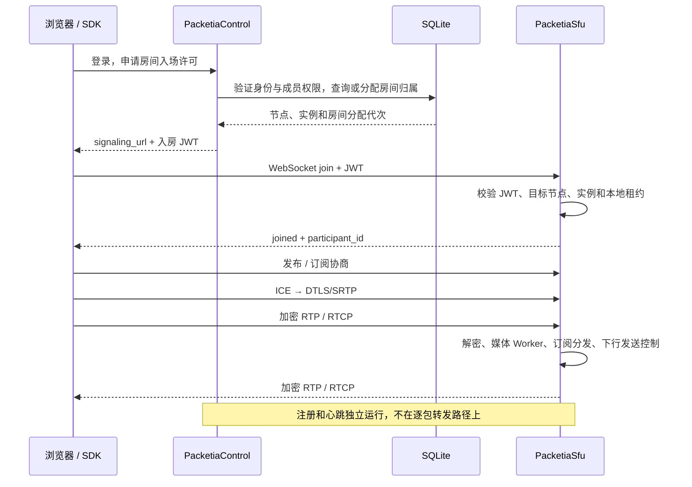

# 控制服务与媒体服务的职责边界

当前集群由一个 `PacketiaControl` 和多个 `PacketiaSfu` 组成。同一房间固定在一个 SFU；
控制服务负责业务权限和节点分配，SFU 持有在线成员、连接与媒体状态。
这是当前实现，不是单房间跨节点转发或多控制服务高可用的设计承诺。

## 一次入房与媒体转发



源码按以下顺序阅读：

1. `server/meeting/RoomController.cpp`：登录会话与业务 HTTP 入口。
2. `service/meeting/RoomAdmissionService.cpp`：房间权限、节点分配、签发 60 秒入房 JWT。
3. `server/signaling/AdmissionValidator.cpp`：入房 / 恢复时本地验证凭证和准入条件。
4. `server/signaling/RoomSignalHandler.cpp`：`JoinRoom()` 建立成员关系，
   `CreateSession()` 组装媒体会话、传输和端点。
5. `protocol/WebRtc/WebRtcSession.cpp`：ICE、DTLS/SRTP、收发加密媒体。
6. `media/transport/MediaEndpointIngress.cpp`：投递媒体工作线程。
7. `media/endpoint/SfuEndpoint.cpp`：接收 RTP 并分发到订阅者。

入房成功不等于媒体已连接。入房 JWT 的到期时间用于校验入房 / 恢复请求，
不会每 60 秒关闭已经建立的媒体会话。

## 状态放在哪里

| 状态 | 归属 | 是否在转发 RTP 时查询 |
| --- | --- | --- |
| 账号、登录会话 | Control 的账号数据库 | 否 |
| 房间业务成员和角色 | Control 的集群数据库 | 否 |
| 节点租约、房间归属、分配代次 | Control 的集群数据库 | 否 |
| 本地准入租约 | SFU 内存中的 `NodeLease` | 入房 / 恢复时检查；媒体转发不依赖它 |
| 在线成员、实时权限、发布和订阅关系 | 房间所属 SFU 内存 | 由本地媒体与信令逻辑使用 |
| ICE、DTLS/SRTP、TWCC、Pacer、发送队列 | 对应 SFU 内存 | 使用本地连接与发送状态 |

`node_id` 区分节点，`instance_id` 区分节点进程实例，`assignment_id` 区分房间归属代次。
房间归属不会因为一次租约超时自动改绑到其他节点，避免原节点仍在转发时创建另一份房间运行时。
同一实例恢复续租后可以继续提供服务；SFU 进程退出则会失去其内存中的会话和媒体状态。

## 控制服务中断时的约定

SFU 每轮心跳后等待约 2 秒。Control 下发 10 秒租约；SFU 从请求发起时刻计时，
预留 2 秒余量，因此本地准入窗口为 8 秒。瞬时失败不会立刻清空租约；
明确收到 401 / 409 则撤销租约并停止心跳循环，需要处理身份或实例冲突。

| 操作 | 租约有效 | 控制服务不可达且本地租约已过期 |
| --- | --- | --- |
| 使用已签发、有效且匹配目标的 JWT 入房 / 恢复 | 继续正常验证 | 拒绝，当前信令错误码为 `forbidden` |
| 通过 Control 申请新的入房许可、修改业务角色 | 正常处理 | Control 不可达，无法完成 |
| 调用 SFU 内部房间管理 HTTP 接口 | 正常验证后处理 | 返回 503 `node_lease_expired` |
| 已入房连接上的合法信令操作 | 按已有实时权限处理 | 仍按已有实时权限处理 |
| 已建立的媒体连接转发音视频 | 正常处理 | 不因控制租约过期而主动关闭 |
| SFU `/healthz` | 200 | 200，表示进程仍在运行 |
| SFU `/readyz` | 200 | 503，表示不再接受新的入房 / 恢复 |

现有媒体仍受自身 ICE 超时、网络故障、主动离房和会话生命周期约束。
控制服务不可用期间，管理员通过控制 API 发起的移除或权限变更也无法送达；
继续服务意味着暂时沿用 SFU 已持有的授权状态。

恢复 Control 后，同一节点实例的心跳可以续租，`/readyz` 恢复 200，重新允许入房 / 恢复。
这与“重启 SFU 后自动恢复通话”不同；后者目前未实现。

部署探针时，应使用 `/healthz` 判断进程存活，使用 `/readyz` 判断准入能力。
不要因准入租约过期自动杀死 SFU 或切断现有 WebSocket / UDP，否则会破坏媒体独立运行的边界。

## 可复现验证

普通集成测试仅需构建后的 Control/SFU 与 Python 标准库：

```sh
cmake --build build/webrtc-integration --target PacketiaControl PacketiaSfu --parallel 4
python3 scripts/test_meeting_control.py \
  --control build/webrtc-integration/server/PacketiaControl \
  --sfu build/webrtc-integration/server/PacketiaSfu
```

测试启动一个 Control 和两个 SFU，验证房间分配、管理权限、代次隔离，并保留一个在线成员，
停止 Control 等到 SFU 租约过期，确认新入房 / 恢复和管理接口被拒绝、已有成员信令仍可用；
重启 Control 后确认归属代次不变，入房 / 恢复重新开放。

可选的真实媒体检查还需要 Node.js、示例的 Playwright 依赖和 Chrome：

```sh
npm --prefix examples/webrtc-room ci
python3 scripts/test_meeting_control.py \
  --control build/webrtc-integration/server/PacketiaControl \
  --sfu build/webrtc-integration/server/PacketiaSfu \
  --media-node node \
  --media-report examples/webrtc-room/artifacts/cluster-outage-result.json
```

`--media-node` 可以填写 Node.js 的绝对路径。默认使用本机 Chrome；
也可通过 `PACKETIA_CHROME_EXECUTABLE` 指定浏览器路径。
测试自行启动临时进程和本机页面，不需要提前启动演示开发服务器。

浏览器使用合成摄像头和麦克风，经过真实业务账号、入房许可、WebSocket、ICE、DTLS/SRTP
及 SFU 转发。检查停机前、租约过期后和续租恢复后三个阶段，确认视频解码帧数、
音频接收字节和发布字节增长，参与者与媒体会话 ID 保持不变，且没有自动重连。
报告只包含会话标识和浏览器计数，不保存 JWT、登录会话凭证、恢复令牌或 SDP。

这是本机故障隔离验证，不能据此推断跨机器容灾、长时间分区行为、公网弱网效果或万人并发容量。

## 后续扩展边界

对外业务回调应通过独立的有界任务队列发送，设置超时与重试，不让媒体线程等待客户 HTTP 接口。
需要可靠交付时，还要定义持久化、事件 ID、幂等和重试耗尽规则；当前事件通知不能直接当作可靠账单。
录制、统计等功能可以先保留为模块，出现独立资源或扩容需求后再拆分部署。
