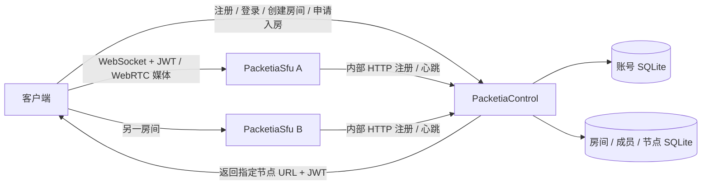

# 控制服务与 SFU 节点

现在有两个可分别部署的进程，原有 `Packetia` 单体入口仍可使用：

| 程序 | 职责 | 入口 |
| --- | --- | --- |
| `PacketiaControl` | 账号、会话、房间成员、节点租约、房间分配、JWT 签发 | `server/cluster/ControlApp.cpp` |
| `PacketiaSfu` | WebSocket 信令、房间参与者、ICE/DTLS/SRTP、媒体转发、节点心跳 | `server/cluster/SfuApp.cpp` |



账号服务没有拆成单独的网络服务，仍位于控制进程。`IService`、`ServerLauncher` 等本地生命周期抽象保持原用途。录制、混流、AI 暂未接入这两个新入口，原入口保留原功能。

## 本机启动

需要现有项目的 OpenSSL、SQLite、FFmpeg、libwebsockets、libsrtp2，以及新增的 libcurl 开发库。macOS 可使用系统 libcurl，其他依赖可通过 Homebrew 安装；Linux 对应开发包见 `deploy/cluster/Dockerfile`。测试构建还需要 GTest。

在项目根目录执行：

```sh
cmake -S . -B build/webrtc-integration -DBUILD_TESTING=ON
cmake --build build/webrtc-integration --target PacketiaControl PacketiaSfu --parallel 6
python3 scripts/run_cluster_local.py
```

脚本会启动 1 个控制进程和 2 个 SFU，自动生成并复用本地密钥；Ctrl+C 停止三个进程。Python 只使用标准库。账号、房间数据和日志位于 `build/cluster-local/`，密钥文件权限为 0600。进程分别使用自己的工作目录，日志不会混写。

本地配置开放注册以便测试，地址如下：

| 用途 | 地址 |
| --- | --- |
| 业务 HTTP | `http://127.0.0.1:18082` |
| 节点内部 HTTP | `http://127.0.0.1:18083` |
| SFU A 信令 / 媒体 | `ws://127.0.0.1:18180/webrtc` / UDP `19100` |
| SFU B 信令 / 媒体 | `ws://127.0.0.1:18181/webrtc` / UDP `19101` |

也可以分别运行 `build/webrtc-integration/server/PacketiaControl CONFIG.json` 和 `build/webrtc-integration/server/PacketiaSfu CONFIG.json`。数据库路径相对于进程工作目录；父目录必须存在。

独立部署的密钥配置由环境变量提供：

| 环境变量 | 哪个进程使用 | 内容 |
| --- | --- | --- |
| `PACKETIA_JWT_ISSUER` | 控制服务和所有 SFU | 同一个签发方标识 |
| `PACKETIA_JWT_SECRET` | 控制服务和所有 SFU | 同一个 HS256 密钥，32～4096 字节 |
| `PACKETIA_NODE_SECRETS` | 控制服务 | JSON 对象：`node_id` 到独立节点密钥，每个至少 32 字节 |
| `PACKETIA_NODE_SECRET` | 单个 SFU | 自己节点的密钥 |

节点密钥与 JWT 密钥分开，不交给客户端。HS256 使用共享签名密钥，SFU 属于受信任的服务端；需要隔离节点的签发能力时，可再切换非对称签名。

## HTTP 测试

以下示例不依赖 jq，先注册和登录：

```sh
curl -i http://127.0.0.1:18082/healthz

curl -i http://127.0.0.1:18082/api/v1/accounts \
  -H 'Content-Type: application/json' \
  -d '{"login":"testuser","password":"example-password","display_name":"测试用户"}'

curl -s http://127.0.0.1:18082/api/v1/sessions \
  -H 'Content-Type: application/json' \
  -d '{"login":"testuser","password":"example-password"}'
```

将登录响应中的 `session_token` 保存到当前终端，再创建房间：

```sh
SESSION_TOKEN='填写登录返回的 session_token'

curl -s http://127.0.0.1:18082/api/v1/rooms \
  -H "Authorization: Bearer $SESSION_TOKEN" \
  -H 'Content-Type: application/json' -d '{}'
```

将返回的 `room_id` 填入，申请入房：

```sh
ROOM_ID='填写 room_id'

curl -s http://127.0.0.1:18082/api/v1/room-admissions \
  -H "Authorization: Bearer $SESSION_TOKEN" \
  -H 'Content-Type: application/json' \
  -d "{\"room_id\":\"$ROOM_ID\"}"
```

响应包含 `room_id`、`node_id`、`instance_id`、`signaling_url`、`token` 和 `expires_at`。客户端连接返回的 `signaling_url`，发送：

```json
{"type":"join","room_id":"返回的房间 ID","token":"返回的入房 JWT"}
```

成功后沿用现有 `publish`、`subscribe`、`tracks`、`resume` 等信令。入房 JWT 不是账号登录凭证，两者不可混用。现有浏览器 demo 的手动签发方式仍面向单体示例；分布式客户端需要先调用入房 HTTP，再使用返回的 URL 和 token。

房主可以添加成员：

```sh
curl -s http://127.0.0.1:18082/api/v1/room-members \
  -H "Authorization: Bearer $SESSION_TOKEN" \
  -H 'Content-Type: application/json' \
  -d "{\"room_id\":\"$ROOM_ID\",\"user_id\":\"另一个已注册用户的 ID\",\"role\":\"listener\"}"
```

创建者自动成为可发布、可订阅的成员。房主可以将其他用户设为 `speaker`（发布和订阅）或 `listener`（仅订阅）。身份来自已验证的登录会话，权限来自持久化成员关系；请求中附加 `user_id`、grants 等字段来申请入房会返回 400。非成员返回 403，未登录返回 401，无可用节点返回 503。成员更新影响后续签发，已经签发的 JWT 和已经建立的连接不会因此自动撤销。

## 节点、租约和分配

- SFU 配置固定 `node_id`；每次启动随机生成新的 `instance_id`。同一 ID 下，尚在租约内的实例会阻止另一实例注册。注册、心跳都使用该节点独立的 Bearer 密钥。
- 节点启动时完成注册，之后每 2 秒发心跳，控制端租约为 10 秒。同一节点重启时会等待旧租约到期，启动注册最多重试约 12 秒。客户端按请求开始的单调时间计时，提前 2 秒停止接受新的 join/resume。单次 HTTP 请求最多阻塞 1.5 秒，心跳运行在独立管理线程，不阻塞媒体 I/O。
- 内部注册和心跳监听与业务 HTTP 分开，使用各自有界工作队列。控制进程提供两个监听，SFU 只开放自身信令和媒体端口。
- 首次入房在 SQLite `BEGIN IMMEDIATE` 事务中分配并保存 `room → node_id + instance_id`。并发申请不会产生两份分配。新房间优先分配给已分配房间比例较低的节点，参与人数用作次级排序；既有房间保持原节点。
- `max_rooms` 是绑定房间的配额；`max_participants` 是 SFU 当前参与者总量的本地硬限制。心跳负载有延迟，分配成功不等于预留了参与者席位，SFU 入房仍会执行容量检查。
- JWT 有效期为 60 秒，绑定用户、房间、节点、实例和媒体权限。SFU 独立验签，再检查节点、实例、租约、房间和具体操作权限。
- 过期租约会阻止新入房和重连；已经建立的信令、媒体会话继续运行。JWT 到期也不会主动踢掉已有参与者。
- 控制服务重启后，同一 SFU 实例的心跳会恢复租约，账号会话、成员关系和房间绑定保留。需要保留两个 SQLite 数据库及其 WAL 状态，不能换成空库后假设旧房间仍可接入。
- SFU 失联后，该房间返回 503；不会自动转移到其他节点。SFU 重启后的新实例只能承接新的房间，旧实例的心跳与凭证会被拒绝；客户端需要重新创建业务房间。这一版不提供无损迁移。

## 当前边界

这是一个控制进程调度多个 SFU 的第一版，尚未实现控制服务高可用、跨 SFU 大房间、动态扩缩容、房间删除/容量回收、成员移除和即时权限撤销、远程录制任务。成员与房间分配持久化，节点历史实例用于隔离过期进程，不会自动清理。每个用户最多创建 100 个房间，每房间最多 1000 个成员；房间长期运行时需要后续补齐结束与回收流程。

SFU 的 ICE/DTLS/SRTP、实时房间对象和媒体轨道仍只存在所属 SFU 的内存里。扩容时新增独立节点配置和节点密钥，启动新的 `PacketiaSfu` 即可；新房间会参与分配，已有房间不会迁移。

公网部署时，业务 HTTP/WS 入口可由现有 TLS 网关提供 HTTPS/WSS。节点内部端口放在私网；配置客户端可达的 `signaling_url` 和真实媒体 `public_ip`，同时放通对应 UDP 端口。`public_ip` 必须是明确的 IP，不能是 `0.0.0.0`。这两个新入口暂未内置 TURN，需要 TURN 的网络环境使用外部 TURN 服务。

## 验证

```sh
cmake --build build/webrtc-integration --target \
  PacketiaControl PacketiaSfu test_cluster test_cluster_api \
  test_auth_framework test_account_api test_webrtc_service test_server_app --parallel 6

ctest --test-dir build/webrtc-integration \
  -R '^(ClusterUnitTest|ClusterApiUnitTest|ClusterProcessIntegrationTest|AuthFrameworkUnitTest|AccountApiFrameworkUnitTest|webrtc_service|server_app)$' \
  --output-on-failure
```

进程测试自动使用临时目录、随机端口和临时密钥，不依赖正在运行的本机服务；验证注册登录、成员权限、并发房间绑定、两节点分配、真实 WebSocket 入房、错误节点/实例拒绝、控制租约过期、控制重启、SFU 失联和重启隔离。它检查控制链路和信令；媒体传输沿用 `webrtc_service` 的现有回归测试，不构成公网弱网或容量压测。

## Docker Compose

提供 `deploy/cluster/compose.yaml`，一个镜像运行三个容器，控制服务的数据写入独立卷；内部 18083 端口仅在 Compose 网络内访问。当前开发环境没有 Docker，此配置尚未完成容器构建验证，本机三进程测试已通过。

先生成本地环境文件（不会输出密钥）：

```sh
python3 - <<'PY'
import os, secrets
from pathlib import Path
path = Path('deploy/cluster/.env')
fd = os.open(path, os.O_WRONLY | os.O_CREAT | os.O_EXCL, 0o600)
with os.fdopen(fd, 'w') as f:
    f.write('PACKETIA_JWT_ISSUER=packetia\n')
    for key in ('PACKETIA_JWT_SECRET', 'PACKETIA_NODE_A_SECRET', 'PACKETIA_NODE_B_SECRET'):
        f.write(key + '=' + secrets.token_hex(32) + '\n')
PY

docker compose -f deploy/cluster/compose.yaml up --build -d
docker compose -f deploy/cluster/compose.yaml logs -f
```

`.env` 已加入忽略列表，已有文件不会被覆盖。容器配置默认关闭账号注册；测试时将 `deploy/cluster/control.json` 的 `registration_enabled` 改为 `true` 后重新启动控制容器。SFU 的 `public_ip` 和 `signaling_url` 默认适用于本机测试；部署到服务器时替换为客户端可达的地址。Linux 上直接映射 TCP 信令和 UDP 媒体端口；Docker Desktop 的 UDP/NAT 可达性仍需在实际网络验证。

停止服务使用 `docker compose -f deploy/cluster/compose.yaml down`。保留 `control-data` 卷和环境文件以保留账号、成员关系及房间绑定。重建 SFU 容器会生成新实例，原有房间按前述规则保持不可用。
